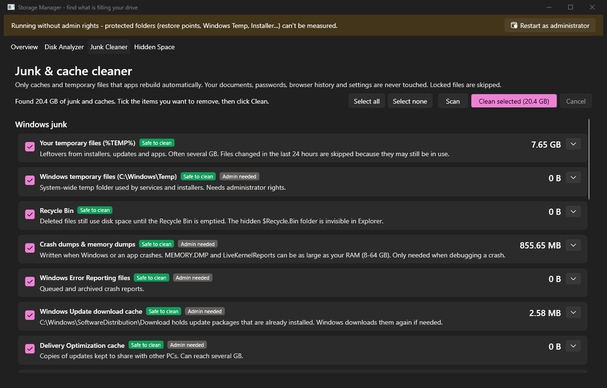
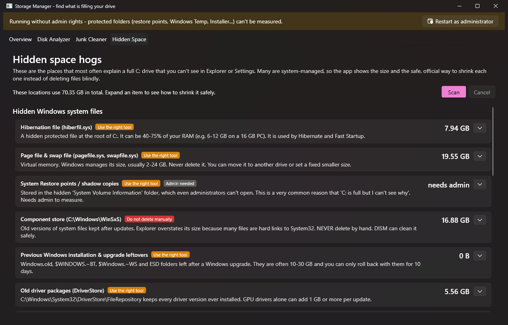

# Windows Storage Cleaner (Storage Manager)

A free, open-source **Windows desktop app (.NET 11 / WPF)** for the classic problem:

> *"My C: drive is full, but I checked installed apps, temp files and Storage settings, and I still can't find what's using the space."*

Storage Manager scans your drive **including hidden and system files**, shows exactly where the space went, cleans safe junk and caches, and explains how to shrink the hidden Windows space hogs (page file, hibernation file, restore points, WinSxS, WSL/Docker disks...) **the official, safe way**.




---

## Table of contents
- [Why your C: drive is full when you can't see the files](#why-your-c-drive-is-full-when-you-cant-see-the-files)
- [Features](#features)
- [Safety](#safety)
- [Requirements](#requirements)
- [Install and run](#install-and-run)
- [How to use it](#how-to-use-it)
- [Packages and technologies used](#packages-and-technologies-used)
- [Project structure](#project-structure)
- [Adding a new cleanup location](#adding-a-new-cleanup-location)
- [FAQ](#faq)
- [Contributing](#contributing)

---

## Why your C: drive is full when you can't see the files

Explorer and *Settings > Storage* hide or under-report a lot. These are the most common culprits (gathered from Microsoft docs, tech guides and user reports):

| Hidden space hog | Typical size | Why you don't see it |
|---|---|---|
| `pagefile.sys` (virtual memory) | 2-24 GB | Hidden, protected file at the root of C: |
| `hiberfil.sys` (hibernation / Fast Startup) | 40-75% of RAM | Hidden, protected file |
| System Restore points / shadow copies | 5-50 GB | Inside `System Volume Information`, which even admins can't open |
| WSL `ext4.vhdx` / Docker Desktop disks | 10-200 GB | Inside AppData. These disks grow but **never shrink** on their own |
| `C:\Windows\WinSxS` component store | 8-20 GB | Old update files. Explorer overstates the size because of hard links |
| `Windows.old`, `$WINDOWS.~BT` upgrade leftovers | 10-30 GB | Hidden system folders |
| App caches in `AppData` (browsers, Teams, Spotify, npm, NuGet, pip, Gradle...) | 1-50 GB | AppData is hidden |
| Crash dumps (`MEMORY.DMP`, LiveKernelReports) | up to RAM size | Inside the Windows folder |
| iPhone backups and iOS update files | 5-100 GB | Deep inside AppData |
| Reserved Storage | ~7 GB | Not shown anywhere |

---

## Features

### Overview
- Every drive with a usage bar (blue/amber/red) and free space.
- One click to analyze a drive.
- Short explanations of the four most common reasons C: fills up.

### Disk Analyzer (WinDirStat / WizTree style)
- **Fast parallel scan**: about 800,000 files in about 5 seconds on an SSD.
- Includes **hidden and system files**.
- **Size-sorted folder tree** with percentage bars. Expand any folder to drill down.
- Side lists:
  - **Largest files** (top 500)
  - **Largest folders**: the folders where the space really is, not their parents
  - **Old big files**: files over 50 MB not changed in more than a year
  - **File types**: total size per extension (`.iso`, `.mp4`, `.vhdx`...)
- **Space accounting**: *Used on drive* vs. *Found by scan* vs. *Hidden system files* vs. *Restore points* vs. *Not accounted for*, so you can see how much space is hidden from normal tools.
- Right-click any item to **Open in Explorer**, **Copy path**, **Move to Recycle Bin** or **Delete permanently**.
- Measures real size on disk: OneDrive "online-only" files count as 0, and compressed/sparse files count at their actual size.
- Junctions/symlinks are not followed, so nothing is counted twice.

### Junk Cleaner
Measures each location, lets you tick what to remove, then cleans it. It only touches data that apps **recreate automatically**:

| Group | Locations |
|---|---|
| Windows junk | `%TEMP%`, `C:\Windows\Temp`, Recycle Bin, crash and memory dumps, Windows Error Reporting, Windows Update download cache, Delivery Optimization cache, old CBS/DISM logs, thumbnail and icon cache, DirectX/NVIDIA/AMD/Intel shader caches |
| Browser caches | Chrome, Edge, Brave (all profiles), Firefox. History, passwords and cookies are **not** touched |
| Developer caches | NuGet, npm, Yarn, pnpm, pip, uv, conda, Gradle, Maven, Go build cache, Cargo, VS Code caches |
| App caches | Teams (classic and new), Discord, Slack, Spotify |

### Hidden Space
Measures the hidden space hogs and gives **the correct fix** for each one, usually a built-in Windows tool:

| Item | Fix offered |
|---|---|
| Hibernation file | `powercfg /h off` (or `/type reduced`) |
| Page file / swap file | Opens Virtual Memory settings, with steps to move it to another drive |
| Restore points | Opens System Protection, plus `vssadmin` commands |
| WinSxS | `DISM /Online /Cleanup-Image /StartComponentCleanup` |
| Windows.old / upgrade leftovers | Disk Cleanup (system files) |
| Old drivers (DriverStore) | Disk Cleanup "Device driver packages", plus `pnputil` |
| Windows Installer cache, Package Cache | Explains why you must not delete them. Opens Installed apps |
| Windows Search index | Opens Indexing Options (Rebuild) |
| Reserved Storage | `DISM /Get-ReservedStorageState` and disable command |
| WSL / Docker `.vhdx` | Lists every virtual disk found, with copyable compaction commands (`Optimize-VHD`, `diskpart compact vdisk`, `docker system prune`) |
| Hyper-V / VirtualBox / VMware / Android emulator disks | Lists them, opens the folder |
| iPhone backups, Outlook `.ost/.pst`, Downloads, OneDrive, game libraries | Shows the size, opens the folder, gives advice |

---

## Safety

The app was designed so that you can't easily break Windows with it:

- **Never follows junctions or symlinks**, either when scanning or when deleting. A link inside a temp folder can never lead to files outside it being deleted.
- **Skips files that are in use**, and skips recently changed files (temp files under 24 hours old, update cache under 2 days, logs under 7 days).
- **Blocks deletion** of drive roots, everything inside `C:\Windows`, the roots of Program Files / ProgramData / Users / your profile / AppData, `WindowsApps`, and `pagefile.sys`, `hiberfil.sys`, `System Volume Information`, `$Recycle.Bin`, `Recovery`, `EFI`...
- **Extra warning** before deleting inside Program Files, ProgramData, AppData, or any `.vhd/.vhdx` virtual disk.
- **System-managed items are never deleted by the app.** It runs the official Microsoft tool and shows you the exact command and asks first.
- Every clean or delete action asks for confirmation. *Move to Recycle Bin* is offered before *Delete permanently*.

> ⚠️ As with any cleanup tool, use it at your own risk and keep backups of important data.

---

## Requirements

| | |
|---|---|
| OS | Windows 10 (1809+) or Windows 11, x64 |
| To **run** | [.NET 11 Desktop Runtime](https://dotnet.microsoft.com/en-us/download/dotnet/11.0) (not needed if you publish self-contained) |
| To **build** | [.NET 11 SDK](https://dotnet.microsoft.com/en-us/download/dotnet/11.0) (11.0.100 or later) |
| Optional | Visual Studio 2026 (18.12+) or VS Code with the C# Dev Kit, or JetBrains Rider |
| Admin rights | Optional, but needed to measure restore points, `C:\Windows\Temp`, WER, the Installer cache and other protected folders. The app has a **Restart as administrator** button |

---

## Install and run

### 1. Install the .NET 11 SDK
Download it from <https://dotnet.microsoft.com/en-us/download/dotnet/11.0>, or use winget:
```powershell
winget install Microsoft.DotNet.SDK.11
```
Check it:
```powershell
dotnet --list-sdks   # should list 11.0.xxx
```

### 2. Get the code
```powershell
git clone https://github.com/YDSilva00/windows-storage-cleaner.git
cd windows-storage-cleaner
```

### 3. Run it
```powershell
dotnet run --project src/StorageManager
```
NuGet packages are restored automatically on the first build.

To open it in Visual Studio, open **`StorageManager.slnx`** and press **F5**.

### 4. Build a standalone .exe (to share with others)

**Small single-file exe** (the other PC needs the .NET 11 Desktop Runtime):
```powershell
dotnet publish src/StorageManager -c Release -r win-x64 --self-contained false -p:PublishSingleFile=true -o publish
```

**Fully self-contained exe** (no .NET install needed, bigger file):
```powershell
dotnet publish src/StorageManager -c Release -r win-x64 --self-contained true -p:PublishSingleFile=true -p:IncludeNativeLibrariesForSelfExtract=true -o publish
```

The app is at `publish\StorageManager.exe`. Copy it anywhere and double-click it.

> Windows SmartScreen may warn about an unsigned app the first time. Click **More info → Run anyway**.

---

## How to use it

1. **Start the app.** If the yellow banner appears, click **Restart as administrator** for complete results.
2. **Overview** → click **Analyze this drive** on C:.
3. **Disk Analyzer**
   - Look at the summary card. If *Not accounted for* is large, the space is in restore points or protected folders (see the Hidden Space tab).
   - Expand the biggest folders in the tree, or check **Largest files** and **Largest folders** on the right.
   - Right-click an item → **Open in Explorer** to inspect it, or **Move to Recycle Bin** if you don't need it. Space is only freed after you empty the Recycle Bin.
4. **Junk Cleaner**
   - Close your browsers and chat apps.
   - Click **Scan**, untick anything you want to keep, then click **Clean selected**.
5. **Hidden Space**
   - Click **Scan**.
   - Expand (˅) the big items to see where they are and **how to fix** them. The main button runs the right Windows tool. **Copy details** copies the commands and found file paths to the clipboard.

### Quick wins that often free 10-40 GB
- Page file: move it to another drive, or set a smaller custom size.
- Hibernation: `powercfg /h off` if you never use Hibernate.
- Restore points: limit System Protection to 5-10%.
- WSL/Docker: run `docker system prune -a`, then compact the `.vhdx`.
- Delete old iPhone backups and `.ipsw` update files.
- Run DISM component cleanup and Disk Cleanup (system files).

---

## Packages and technologies used

| Package / technology | Version | Used for |
|---|---|---|
| [.NET](https://dotnet.microsoft.com/) | 11.0 | Runtime / SDK |
| WPF (Windows Presentation Foundation) | part of .NET 11 | Desktop UI, with the built-in **Fluent theme** (`ThemeMode="System"`, so it follows Windows light/dark mode) |
| [CommunityToolkit.Mvvm](https://www.nuget.org/packages/CommunityToolkit.Mvvm) | 8.4.2 | MVVM: `ObservableObject`, `[ObservableProperty]` partial properties, `[RelayCommand]` async commands |
| [System.Management](https://www.nuget.org/packages/System.Management) | 11.0.0 | WMI queries (`Win32_ShadowStorage`, `Win32_Volume`) to measure restore points / shadow copies |
| Microsoft.VisualBasic (`FileSystem`) | part of .NET | Sending files and folders to the Recycle Bin |
| Win32 APIs (via `LibraryImport`) | `shell32`, `kernel32` | `SHQueryRecycleBin`, `SHEmptyRecycleBin`, `GetCompressedFileSize` |
| `System.IO.Enumeration.FileSystemEnumerable` | part of .NET | Low-allocation, high-speed directory enumeration for the scanner |

No other third-party dependencies.

---

## Project structure

```
windows-storage-cleaner/
├── StorageManager.slnx                 # Solution
├── README.md
├── docs/screenshots/
└── src/StorageManager/
    ├── StorageManager.csproj           # net11.0-windows, WPF, package references
    ├── app.manifest                    # asInvoker, PerMonitorV2 DPI, long paths
    ├── App.xaml(.cs)                   # Fluent theme, shared styles, converters, error handler
    ├── MainWindow.xaml(.cs)            # UI: Overview, Disk Analyzer, Junk Cleaner, Hidden Space tabs
    ├── Models/
    │   └── FsNode.cs                   # Tree node (folder / file / small-files group / link / access denied)
    ├── Services/
    │   ├── DiskScanner.cs              # Parallel scanner, largest files, file types
    │   ├── FileCleaner.cs              # Size calculation + safe deletion (no link following, age filter)
    │   ├── SpaceHogCatalog.cs          # ★ All cleanup / hidden-space definitions (paths, safety, fixes, advice)
    │   ├── PathGuard.cs                # Protected-path rules for deletion
    │   ├── SystemHelper.cs             # Admin, restart elevated, WMI shadow storage, Recycle Bin, run commands
    │   └── NativeMethods.cs            # Win32 P/Invoke
    ├── ViewModels/
    │   ├── MainViewModel.cs
    │   ├── DriveViewModel.cs
    │   ├── AnalyzerViewModel.cs
    │   └── CleanupViewModels.cs        # Cleanup item + Junk/Hidden tab view models
    └── Converters/
        └── Converters.cs               # Bytes, percent, visibility, color converters
```

### How the scanner works
- It enumerates each directory once with `FileSystemEnumerable` (no `FileInfo` allocations) and recurses **in parallel for the top 3 levels**.
- Hidden and system attributes are **not** skipped. Reparse-point directories are recorded but not followed.
- Files of **1 MB or more** are kept as individual nodes. Smaller files are grouped per folder into a "[N files smaller than 1 MB]" node, which keeps memory around 100 MB even for a million files.
- Sizes are summed bottom-up and children are sorted largest-first.

---

## Adding a new cleanup location

Everything lives in **`Services/SpaceHogCatalog.cs`**. Add a `CleanupDefinition`:

```csharp
new()
{
    Id = "my-app-cache",
    Area = Area.JunkCleaner,                 // or Area.HiddenSpace
    Group = "App caches",
    Title = "My App cache",
    Description = "What it is and why it's safe to delete.",
    Safety = Safety.Safe,                    // Safe | Caution | DoNotDelete
    Paths = [@"%LOCALAPPDATA%\MyApp\Cache", @"%APPDATA%\MyApp\*\GPUCache"],  // env vars + '*' folder wildcards
    FilePatterns = ["*.tmp"],                // optional
    MinAge = TimeSpan.FromDays(1),           // optional: skip newer files
    NeedsAdmin = false,
    // For Area.HiddenSpace items you usually set Method = CleanMethod.None and give a fix:
    // FixLabel = "Open settings", FixCommand = "ms-settings:...", FixIsShellOpen = true,
    // Advice = "Step-by-step instructions / commands"
},
```

Pull requests with new well-known cache locations are welcome. Please only mark something `Safe` if the owning app recreates it automatically.

---

## FAQ

**Why is "Found by scan" lower than "Used on drive"?**
The difference is usually restore points (shadow copies), NTFS metadata (`$MFT`), Reserved Storage, and folders you can't read without admin rights. Run as administrator to reduce the gap.

**Why does WinSxS look huge?**
Many of its files are hard links shared with `System32`, so the scan counts them twice. Use `Dism /Online /Cleanup-Image /AnalyzeComponentStore` to see its real size.

**I cleaned the WSL/Docker data but the `.vhdx` is still big.**
Virtual disks don't shrink automatically. Run `wsl --shutdown`, then compact the disk (`Optimize-VHD`, or `diskpart` on Windows Home). The commands are in the Hidden Space tab.

**Is it safe to delete pagefile.sys or hiberfil.sys?**
Not by hand. Use the buttons in the Hidden Space tab: move or shrink the page file via Virtual Memory settings, and use `powercfg /h off` for the hibernation file.

**Does Junk Cleaner delete my browser passwords or history?**
No. Only the cache folders (`Cache`, `Code Cache`, `GPUCache`, Service Worker cache) are cleaned.

---

## Contributing

1. Fork the repo and create a branch: `git checkout -b feature/my-change`
2. Build and test: `dotnet build`, then run the app
3. Commit and open a pull request

Bug reports and ideas are welcome in **Issues**.
